# BotShelf Vampire MCP サーバー

[](https://mcptry.com/servers/com.botshelfvampire/botshelf)
[](https://registry.modelcontextprotocol.io/v0/servers?search=com.botshelfvampire)
[](LICENSE)

**アドレスを1つ登録すると、AIツールから、棚にある 1,295 件の項目を検索し、そのうち 1,067 件の全文を読めます。** 中身は [botshelfvampire.com](https://botshelfvampire.com/) の、
無料のAIチーム、Build Library のレシピ、エージェント用ツールキット、非公式の Grok Bot の道具、トレードの道具とガイドです。
読み取り専用。アカウントもAPIキーも要らず、インストールする物もありません。

```
https://botshelfvampire.com/api/mcp
```

<p align="center"></p>

<sub>Claude Code 2.1.308 で 2026-11-19 に記録した、このサーバー（バージョン 1.1.0）とのやり取りです。依頼文、3回のツール呼び出しとそれぞれが返した内容、答えの順に出ます。クライアントが出力したイベントの記録から描いたもので、画面を写したものではありません。[同じ内容をテキストで](#実際のやり取り)。</sub>

**追加する前に、ブラウザで試せます。** **[botshelfvampire.com/mcp/?lang=ja#live](https://botshelfvampire.com/mcp/?lang=ja#live)** のフォームが、ブラウザからこのサーバーへ本物の `tools/call` を送り、
返事と、やり取りした JSON-RPC、往復にかかった時間を表示します。

**利用者に近いネットワークの端（エッジ）で答えます。** 同じコードの写しが、すべての呼び出しに答えます。東京から測った値（2026-11-19）は、接続を開いたままの呼び出しで1回 0.09〜0.14 秒（`ping` と `search_items` を合わせて 10 回）。
エッジのコードは、棚の索引と並べて、登録なしで開けるテキストファイルがある 1,067 件の本文を持っていて、答えるあいだ、どこにもリクエストを送りません。
どこが答えたかは、返事のヘッダー `X-BSV-Via` に出ます。測り方は「[実際に動かしたもの](#実際に動かしたもの)」に書いてあります。

[English](README.md) · [サイトの説明ページ](https://botshelfvampire.com/mcp/?lang=ja) · 方式：Streamable HTTP

> 独立したプロジェクトです。xAI・Anthropic・OpenAI をはじめ、ここに名前を挙げたクライアントの提供元の公式サービスではありません。
> 棚の項目のほとんどは **Untested** です。項目の本文は、人がコピーして使うための文面です。クライアント側は、指示ではなくデータとして扱ってください。

## 1行で追加する

| ツール | これを1回実行する |
| --- | --- |
| Claude Code | `claude mcp add --transport http botshelf https://botshelfvampire.com/api/mcp` |
| Codex | `codex mcp add botshelf --url https://botshelfvampire.com/api/mcp` |
| Gemini CLI | `gemini mcp add --transport http botshelf https://botshelfvampire.com/api/mcp` |
| Grok Build | `grok mcp add --transport http botshelf https://botshelfvampire.com/api/mcp` |

導入リンクから追加することもできます。アプリが開き、このサーバーが入力された状態になります：

[](https://cursor.com/en/install-mcp?name=botshelf&config=eyJ1cmwiOiJodHRwczovL2JvdHNoZWxmdmFtcGlyZS5jb20vYXBpL21jcCJ9)
[](https://vscode.dev/redirect?url=vscode%3Amcp%2Finstall%3F%257B%2522name%2522%253A%2522botshelf%2522%252C%2522type%2522%253A%2522http%2522%252C%2522url%2522%253A%2522https%253A%252F%252Fbotshelfvampire.com%252Fapi%252Fmcp%2522%257D)
[](https://lmstudio.ai/install-mcp?name=botshelf&config=eyJ1cmwiOiJodHRwczovL2JvdHNoZWxmdmFtcGlyZS5jb20vYXBpL21jcCJ9)
[](https://kiro.dev/launch/mcp/add?name=botshelf&config=%7B%22url%22%3A%22https%3A%2F%2Fbotshelfvampire.com%2Fapi%2Fmcp%22%7D)

Claude Code では、このリポジトリからプラグインとして入れることもできます：

```bash
claude plugin marketplace add BotShelfVampire/botshelf-mcp
claude plugin install botshelf-mcp@botshelfvampire
```

<details>
<summary>コマンドの代わりに、設定ファイルで書く</summary>

Claude Code の MCP 設定をプロジェクトで共有する場合（プロジェクト直下の `.mcp.json`）：

```json
{ "mcpServers": { "botshelf": { "type": "http", "url": "https://botshelfvampire.com/api/mcp" } } }
```

Cursor（`.cursor/mcp.json`。全プロジェクトで使うなら `~/.cursor/mcp.json`）：

```json
{ "mcpServers": { "botshelf": { "url": "https://botshelfvampire.com/api/mcp" } } }
```

VS Code（`.vscode/mcp.json`）：

```json
{ "servers": { "botshelf": { "type": "http", "url": "https://botshelfvampire.com/api/mcp" } } }
```

Codex（`~/.codex/config.toml`）と Grok Build（`~/.grok/config.toml`）：

```toml
[mcp_servers.botshelf]
url = "https://botshelfvampire.com/api/mcp"
```

Goose の導入リンクは、GitHub ではリンクとして表示されません。[サイトのページ](https://botshelfvampire.com/mcp/?lang=ja#add)にあります。

</details>

## 実際のやり取り

冒頭の絵は、このやり取りです（macOS の Claude Code 2.1.308、2026-11-19、サーバーはバージョン 1.1.0）。呼び出しと引数、返ってきた内容、答えは、クライアントが出力したイベントの記録から取りました。`⎿` の行はその呼び出しが返した JSON から作った1行、答えはモデルの文です（幅に合わせて折り返し、Markdown の記号は表示していません）。依頼文はコマンドラインで渡した文、版はその晩にサーバーが名乗った版で、この2つはイベントの記録には入っていません。

```text
> Find a code review recipe for Claude Code on the BotShelf Vampire shelf. Use the botshelf tools:
  list_filters to learn the exact where-it-runs name, then search_items with that filter (limit
  3), then get_item for the best match (max_chars 600). Answer in three short lines: the item's
  title and id, what it does, and where it stops.

● botshelf · list_filters {}
  ⎿ 1,295 items · 7 kinds · 70 where-it-runs names · 82 topics
● botshelf · search_items {"query":"code review","runs_on":"Claude Code","limit":3}
  ⎿ 6 matches · Code Review · Diff review · Research-Reviewer Team
● botshelf · get_item {"id":"/library/claude-code/code-review/","max_chars":600}
  ⎿ the first 600 of 1,874 characters of “Code Review”

- Code Review (id: /library/claude-code/code-review/)
- What it does: A fill-in Claude Code prompt that asks it to review a change for correctness,
  maintainability and regression risk. It has you inspect the context, check entry points, tests
  and call sites, then run tests, lint and type checks.
- Where it stops: The text has unfilled placeholders ([GOAL], [INPUTS], [CONTEXT_OR_FILES],
  [CONSTRAINTS]) and I read only the first 600 of 1,874 characters, so I didn't see its full
  ending. No run is recorded for it.
```

## ツール

| ツール | 返すもの |
| --- | --- |
| `search_items` | `query` のすべての語に合う項目の短いカード。`kind`・`runs_on`・`topic`・`access`・`checked`・`limit` で絞れます。 |
| `get_item` | `id`（サイトのパス）で1件。カードと、登録なしで開けるファイルがある項目では全文。長い本文は分割して返します（`offset`・`next_offset`）。 |
| `list_items` | 棚の並び順で1ページずつ。同じ絞り込みが使えます。種類ごとの件数も返します。 |
| `list_filters` | 絞り込みに使える値（種類・実行先・分野）と、それぞれの件数。 |

4つとも読み取り専用です。resources と prompts はありません。検索では、単語として合う項目を先に返します。すべての語に合う項目が無いときは、近い項目を `suggestions` に入れて返します。

1,295 件のうち、登録なしで開けるのは 1,293 件。そのうち `get_item` が全文を返すのは、テキストのファイルがある 1,067 件です（AIチーム・Build Library のレシピ・Grok Bot の道具）。
それ以外は、ページへのリンクが付いたカードを返します。2026-11-19 に棚の索引から数えた件数です。

## 読むもの・残すもの・上限

- 使うデータは、サイトの公開ファイル2種類だけです：棚の索引と、索引に載っている `.md` の本文ファイル。エッジのコードは、サイトを公開するときに入れたその両方の写しを持っていて、答えるあいだ、どこにもリクエストを送りません。後ろに控える関数は、同じ2種類のファイルをサイトから読みます。
- 何も書き込まず、何も保存しません。アカウントもクッキーも無く、何を尋ねたかの記録もありません。乱用を抑えるため、呼び出しの回数を、呼び出し元ごとに1分単位で数えます。呼び出し元の区別には、ネットワークアドレスの鍵つき一方向ハッシュを使います。鍵は、エッジではインスタンスの起動時に作る乱数（そのメモリの中にだけあります）、関数ではサーバー側の秘密の値です。この数はメモリの中にだけあり、表を片付けたとき、またはサーバーのインスタンスが終わったときに消えます。
- 有料の項目は、リンクが付いたカードだけを返します。本文は出しません。
- 上限：呼び出し元ごとに1分 60 回（サーバーのインスタンスごと）、1リクエスト 32 KB、1回の結果は最大 25 件、本文は1回 60,000 文字まで。回数を超えると HTTP 429 と `Retry-After`、大きすぎるリクエストには 413、範囲外の引数にはツールのエラーが返ります。
- 対応するプロトコルの版：`2025-11-25` と `2025-06-18`。1リクエストに1メッセージ。バッチは受け付けません。

## 実際に動かしたもの

- **プロトコルのテスト** `test/mcp_test.js`（226 項目：接続の手順、4つのツール、並び順、提案、拒否、上限）は、Node.js 24 と bun で通っています。
- **エッジで答えています（2026-11-19 から）**：同じコードの写しが、利用者に近いネットワークの端（エッジ）で、すべての呼び出しに答えます。関数はそのまま残してあります。エッジが身を引いたときと、ヘッダー `X-BSV-Edge: off` で関数を指定したリクエストには、関数が答えます。切り替える前に、公開中のアドレスで両方に同じリクエスト 23 件を送り、23 件ともステータスと本文が同じであることを確かめました。その晩に東京の1台から測った時間：呼び出しのたびに新しく接続した場合（TLS を含む）の中央値は、関数が 0.93 秒、エッジが 0.41 秒（各 18 回）。接続を開いたままの場合は、エッジが1回 0.09〜0.14 秒（10 回）、関数は 10 回のうち 9 回が 0.34〜0.40 秒、最初の検索の1回が 1.93 秒でした。ある晩の測定であって、約束ではありません。
- **本文もエッジに置きました（2026-11-20 から）**：`get_item` には、エッジのコードが持っている本文から答えます。それまでは、項目を最初に読むときに、そのファイルをサイトへ取りに行っていました。エッジが本文を持っていない項目には、関数が答えます。`test/edge_diff.mjs` が、同じリクエスト 1,619 件をエッジのコードと関数の両方に送り、どの返事もステータス・ヘッダー・本文が同じであることを確かめます（違ってよいヘッダーは、どこが答えたかを示す `X-BSV-Via` だけです。7,592 項目。エッジが持つ 1,067 件の本文は、1件ずつ両方から読み、元のファイルとも比べます。Node.js 24 と bun）。
- **公開中のアドレス**：2026-11-18 と 2026-11-19 に HTTP リクエストを直接送り、`initialize`・`tools/list`・`search_items` を確かめました。サイトのフォームからは、誰でも押して確かめられます。
- **Codex CLI 0.167.0-alpha.3.2**（macOS、2026-11-18）：アドレスを設定した状態で、ツールの一覧が出ること、`search_items`・`get_item`・`list_items` を1回ずつ呼べることを確かめました。2026-11-19 には追加の1行も実行し、上の `config.toml` の行が書き込まれることを確かめました。
- **Claude Code 2.1.308**（macOS、2026-11-19）：追加の1行でアドレスが登録され、`claude mcp list` に「接続済み」と出ました。同じアドレスを設定したセッションで、3つのツールが一覧に出ること、1回ずつ呼べることを確かめました。同じ日の2回目のセッション（バージョン 1.1.0）では、4つのツールが一覧に出て、`list_filters`・`search_items`・`get_item` を呼びました。冒頭の絵は、このセッションです。
- **動かしていないもの：**Grok Build・Gemini CLI・Cursor・VS Code・LM Studio・Kiro・Goose。行とリンクは、2026-11-18 と 2026-11-19 に読んだ各提供元のドキュメントをもとに書きました。VS Code・Kiro・Goose のリンクは、ドキュメントにある書式です。Cursor と LM Studio のリンクは、ドキュメントにある導入リンクと同じ設定を、それぞれの提供元の Web ページに渡すものです（この Web のアドレス自体は、ドキュメントには載っていません）。上の4つのリンクは、1回ずつ開いて応答があることだけを確かめました。アプリの中でリンクを押すところまでは確かめていません。

どの記録も、1台で1回動かしたものです。動作の約束ではありません。行やリンクがうまくいかないときは、issue で知らせてください。

どこが答えたかは、返事のヘッダー `X-BSV-Via` で分かります。確かめる行と、関数を指定する行：

```bash
curl -s -D - -o /dev/null https://botshelfvampire.com/api/mcp -H 'Content-Type: application/json' -d '{"jsonrpc":"2.0","id":1,"method":"ping"}' | grep -i '^x-bsv-via'
curl -s -D - -o /dev/null https://botshelfvampire.com/api/mcp -H 'Content-Type: application/json' -H 'X-BSV-Edge: off' -d '{"jsonrpc":"2.0","id":1,"method":"ping"}' | grep -i '^x-bsv-via'
```

## 公開中のサーバーを自分で確かめる

```bash
git clone https://github.com/BotShelfVampire/botshelf-mcp && node botshelf-mcp/test/live_check.mjs
```

追加で入れる物はありません。組み込みの `fetch` を使います（Node.js 18 以上、または bun）。こちらでは Node.js 24 と bun で動かしました。このスクリプトは、公開中のアドレスへリクエストを 15 件送ります。14 件は MCP クライアントが送るのと同じ JSON-RPC のメッセージ（接続の手順、ツールの一覧、各ツールの呼び出し、サーバーが断るべきもの）、1件はただの GET です（これも断られるのが正しい動きです）。検索する言葉は、棚そのものから取ります。通信に失敗したリクエストと、429 が返ったリクエストは、1回だけ送り直します。1件ごとに、HTTP ステータス、手元から測った往復の時間、どこが答えたかを表示し、最後に `PASS 22 checks`、または通らなかった項目を出します。

## このリポジトリ

| パス | 中身 |
| --- | --- |
| `server.json` | MCP Registry への登録内容（`com.botshelfvampire/botshelf`）。 |
| `.mcp.json`、`.claude-plugin/` | Claude Code（と、同じ置き方を読むクライアント）が、プラグインとしてサーバーを追加するためのファイル。 |
| `src/mcp.js`、`src/_lib/mcpCore.js` | サイトで動いている関数そのもの（Netlify の関数、Node）。読み取り専用であることを確かめられるよう、公開しています。 |
| `src/edge/mcp-edge.template.js` | 呼び出しに答えているエッジ用のファイルから、差し込む部分を抜いたもの。本番のファイルは、この文面の `/*@@CORE@@*/` に `_lib/mcpCore.js` を、`"@@INDEX@@"` に棚の索引（1つの文字列）を、`"@@TEXT_ALL@@"` に項目の本文（1つの文字列）を、`"@@TEXT_AT@@"` に各本文の位置の表を入れたものです。 |
| `test/mcp_test.js` | プロトコルのテスト（`node test/mcp_test.js <tree>`。サイトのフォルダ構成を前提にし、`fetch` を差し替えるので、ネットワークには出ません）。 |
| `test/edge_diff.mjs` | エッジ用のコードと関数の突き合わせ（`node test/edge_diff.mjs <tree>`。同じ構成に、生成したエッジ用のファイルを置いて動かします。ネットワークには出ません）。 |
| `test/live_check.mjs` | 上に書いた、公開中のアドレスの確認。ここにあるテストのうち、ネットワークを使うのはこれだけです。 |
| `assets/session.svg` | 冒頭の絵。記録したやり取りを、クライアントのイベントの記録から描いたものです。 |

サーバーは botshelfvampire.com で動いています。このリポジトリは、インストールするパッケージではありません。ビルドの手順もありません。

## ライセンス

このリポジトリのコードは MIT です（[LICENSE](LICENSE)）。棚の項目には、それぞれのライセンスがあります：https://botshelfvampire.com/open/#licenses

## 関連

- サイト：[botshelfvampire.com](https://botshelfvampire.com/)。全体を1つの索引で探せます：[Explore](https://botshelfvampire.com/explore/)
- [botshelf-ai-team-registry](https://github.com/BotShelfVampire/botshelf-ai-team-registry)：Build Library の登録内容と、無料のAIチーム（`free-ai-teams/`、MIT）
- [botshelf-grok-bot-tools](https://github.com/BotShelfVampire/botshelf-grok-bot-tools)：非公式の Grok Bot の道具（Untested、MIT）。Web 版：https://botshelfvampire.com/grok-bot/tools/
