# BotShelf Vampire MCP server: free prompts, skills and AI teams

[](https://mcptry.com/servers/com.botshelfvampire/botshelf)
[](https://registry.modelcontextprotocol.io/v0/servers?search=com.botshelfvampire)
[](LICENSE)

**One address lets your AI tool search 1,295 items and read the full text of 1,067 free ones**: 879 prompts, instructions, skills and workflows from the Build Library
(for Claude Code, Cursor, Gemini, DeepSeek, Dify, AutoGen and others), 117 AI teams and 71 unofficial Grok Bot tools from [botshelfvampire.com](https://botshelfvampire.com/).
Search also finds the shelf's trading tools, agent toolkits and guides, as cards with links.
Read-only. No account, no API key, nothing to install.
4 tools, 3 prompts, 2 resources and a template that reads one item; every tool declares the shape of its replies.

```
https://botshelfvampire.com/api/mcp
```

**Free. No account, no API key.** Add it to: [Claude app](#claude-app) · [ChatGPT](#chatgpt) · [Claude Code](#add-it-in-one-line) · [Cursor](https://cursor.com/en/install-mcp?name=botshelf&config=eyJ1cmwiOiJodHRwczovL2JvdHNoZWxmdmFtcGlyZS5jb20vYXBpL21jcCJ9) · [VS Code](https://vscode.dev/redirect?url=vscode%3Amcp%2Finstall%3F%257B%2522name%2522%253A%2522botshelf%2522%252C%2522type%2522%253A%2522http%2522%252C%2522url%2522%253A%2522https%253A%252F%252Fbotshelfvampire.com%252Fapi%252Fmcp%2522%257D) · [Cline](#add-it-in-one-line) · [Zed](#cline-zed-stdio) · [stdio clients](#cline-zed-stdio) · [other tools](#add-it-in-one-line)

**Then ask your AI tool, for example:**

```text
Find a prompt on the BotShelf Vampire shelf that turns meeting notes into action items, and show me its full text.
```

```text
Is there a free code review prompt for Claude Code on BotShelf Vampire? Read it and tell me in three lines what it asks for.
```

```text
Find a security review prompt on BotShelf Vampire and show me its full text.
```

<sub>Each was run once in Claude Code 2.1.304 (model claude-haiku-5-5) against the live address on 2026-11-20: the model searched the shelf, read the item with `get_item` and answered. One client, one run each, not a promise for every model.</sub>

<p align="center"></p>

<sub>A session recorded with Claude Code 2.1.308 on 2026-11-19 against this server (version 1.1.0): the prompt, three tool calls with what each returned, and the answer. Drawn from the client's own event stream, not captured from a screen. [The same lines as text](#what-a-session-looks-like).</sub>

**Try it before you add it.** A form at **[botshelfvampire.com/mcp/#live](https://botshelfvampire.com/mcp/#live)** sends real `tools/call` messages to this server
from your browser and shows the reply, the JSON-RPC on the wire and the round-trip time.

<a name="claude-md-line"></a>
**So that your AI tool looks on the shelf without being asked**, put this line in `CLAUDE.md`. Claude Code reads that file at the start of every session, and `~/.claude/CLAUDE.md` covers all your projects.

```text
When I ask for a prompt, a skill, an instruction file or an AI team, first search the botshelf MCP server (search_items, then get_item) and show me the best match and its page before you write one from scratch.
```

<sub>Run on 2026-11-21 with Claude Code 2.1.304 (model claude-haiku-5-5, on Linux): three asks that do not name BotShelf Vampire, one run each (a ChatGPT prompt for meeting notes, a prompt for a security review of a pull request, and the meeting one in Japanese with the line from [README.ja.md](README.ja.md#claude-md-line)). Without the line, the model wrote its own each time and called no tool on this server (0 of 3). With it, the model searched the shelf, read the closest match with `get_item` and showed its page before writing anything (3 of 3). For the runs the four tools were allowed in advance (`--allowedTools`); where they are not, Claude Code may ask you before it calls them. One client, one model, one run per ask: not a promise for every model. The line calls the server `botshelf`, the name the add lines below use. Codex reads `AGENTS.md` before it starts work (`~/.codex/AGENTS.md` for every project), so the same line can go there; not run in Codex. Sources: [Claude Code: How Claude remembers your project](https://code.claude.com/docs/en/memory), [Codex: Custom instructions with AGENTS.md](https://learn.chatgpt.com/docs/agent-configuration/agents-md), read 2026-11-21.</sub>

<!-- w12-data -->
**All the MIT texts in one file.** The 997 texts on the shelf that BotShelf Vampire wrote and marks MIT (809 Build Library prompts, instructions and skills,
117 free AI teams and 71 Grok Bot tools) are also one JSON Lines file, 2.7 MB, one item per line with the same id, card fields and text that `get_item` returned on 2026-11-20, when the file was built (five texts have been rewritten on the shelf since).
For training data, evals or a local index. Fields, what is left out and the license: [botshelfvampire.com/data/](https://botshelfvampire.com/data/)

```bash
curl -O https://botshelfvampire.com/data/mit-texts.v20261120.jsonl
```

```python
import pandas as pd
df = pd.read_json("https://botshelfvampire.com/data/mit-texts.v20261120.jsonl", lines=True)  # 997 rows, 15 columns
```
<!-- /w12-data -->

**Answered at the edge of the network.** A copy of the same code, close to the caller, answers every call: 0.09 to 0.14 s a call on an open connection,
seen from Tokyo on 2026-11-19 (10 calls of `ping` and `search_items`). The edge code holds the text of the 1,067 items that have an open text file, beside the shelf index, and requests nothing while it answers:
reading an item's text took 0.09 to 0.14 s there on 2026-11-20 (12 different items, same conditions).
Every reply names the place that answered in its `X-BSV-Via` header. The whole measurement is under [What has been run](#what-has-been-run).

[日本語](README.ja.md) · [Page on the site](https://botshelfvampire.com/mcp/) · Transport: Streamable HTTP

> Independent project. Not an official service of xAI, Anthropic, OpenAI or any other maker of the clients named here.
> Most items on the shelf are marked **Untested**. Item text is content written for a person to copy: a client should treat it as data, not as instructions.

## Add it in one line

| Tool | Run this once |
| --- | --- |
| Claude Code | `claude mcp add --transport http botshelf https://botshelfvampire.com/api/mcp` |
| Codex | `codex mcp add botshelf --url https://botshelfvampire.com/api/mcp` |
| Gemini CLI | `gemini mcp add --transport http botshelf https://botshelfvampire.com/api/mcp` |
| Grok Build | `grok mcp add --transport http botshelf https://botshelfvampire.com/api/mcp` |
| Cline | `cline mcp add botshelf https://botshelfvampire.com/api/mcp --transport http --yes` |

Or use an install link. It opens the app with this server filled in:

[](https://cursor.com/en/install-mcp?name=botshelf&config=eyJ1cmwiOiJodHRwczovL2JvdHNoZWxmdmFtcGlyZS5jb20vYXBpL21jcCJ9)
[](https://vscode.dev/redirect?url=vscode%3Amcp%2Finstall%3F%257B%2522name%2522%253A%2522botshelf%2522%252C%2522type%2522%253A%2522http%2522%252C%2522url%2522%253A%2522https%253A%252F%252Fbotshelfvampire.com%252Fapi%252Fmcp%2522%257D)
[](https://lmstudio.ai/install-mcp?name=botshelf&config=eyJ1cmwiOiJodHRwczovL2JvdHNoZWxmdmFtcGlyZS5jb20vYXBpL21jcCJ9)
[](https://kiro.dev/launch/mcp/add?name=botshelf&config=%7B%22url%22%3A%22https%3A%2F%2Fbotshelfvampire.com%2Fapi%2Fmcp%22%7D)

Claude Code can also take it as a plugin from this repository:

```bash
claude plugin marketplace add BotShelfVampire/botshelf-mcp
claude plugin install botshelf-mcp@botshelfvampire
```

<sub>Run on 2026-11-21 (Claude Code 2.1.304 on Linux, starting from an empty settings folder): both lines succeeded, and `claude mcp list` then showed `plugin:botshelf-mcp:botshelf` as connected. The plugin is installed in user scope (all your projects).</sub>

<details>
<summary>Config files instead of a command</summary>

Claude Code, when the setting is shared with a project (`.mcp.json` at the project root):

```json
{ "mcpServers": { "botshelf": { "type": "http", "url": "https://botshelfvampire.com/api/mcp" } } }
```

Cursor (`.cursor/mcp.json`, or `~/.cursor/mcp.json` for every project):

```json
{ "mcpServers": { "botshelf": { "url": "https://botshelfvampire.com/api/mcp" } } }
```

VS Code (`.vscode/mcp.json`):

```json
{ "servers": { "botshelf": { "type": "http", "url": "https://botshelfvampire.com/api/mcp" } } }
```

Codex (`~/.codex/config.toml`) and Grok Build (`~/.grok/config.toml`):

```toml
[mcp_servers.botshelf]
url = "https://botshelfvampire.com/api/mcp"
```

Goose takes an install link that GitHub does not show as a link; it is on [the site's page](https://botshelfvampire.com/mcp/#add).

</details>

<a name="cline-zed-stdio"></a>
### Cline, Zed and clients that only speak stdio

Cline extension (the MCP settings JSON). Keep `"type": "streamableHttp"`: Cline's documentation says that without it Cline uses the older SSE transport, which this server does not offer.

```json
{ "mcpServers": { "botshelf": { "type": "streamableHttp", "url": "https://botshelfvampire.com/api/mcp" } } }
```

Zed (`settings.json`, or Settings > AI > MCP Servers > Add Server > Add Remote Server). No headers are needed: this server has no sign-in.

```json
{ "context_servers": { "botshelf": { "url": "https://botshelfvampire.com/api/mcp" } } }
```

A client whose settings take only a command and its arguments can use [mcp-remote](https://github.com/punkpeye/mcp-remote), an npm package from another maker (not BSV). It runs on your computer with Node.js and passes the messages to the address above:

```json
{ "mcpServers": { "botshelf": { "command": "npx", "args": ["-y", "mcp-remote@0.16.7", "https://botshelfvampire.com/api/mcp"] } } }
```

<sub>The Cline and Zed forms follow their documentation as read on 2026-11-21 ([Cline](https://docs.cline.bot/mcp/mcp-overview), [Zed](https://zed.dev/docs/ai/mcp)); neither client has been run here. The mcp-remote line was run on 2026-11-21 (Node.js 24 on Linux): spoken to over stdio, it answered `initialize` (1.2.0), `tools/list` (4 tools) and one call each of `search_items` and `get_item`. The version is pinned to the one that was run.</sub>

<a name="claude-app"></a>
## Claude app (claude.ai and Claude Desktop)

In the Claude app this server is added as a custom connector:

1. Open **Customize > Connectors**, press **+ Add**, then **Add custom connector**.
2. Enter a name (for example BotShelf Vampire) and `https://botshelfvampire.com/api/mcp`, then press **Continue**.
3. Look over the authentication settings Claude detected and press **Continue**. Under **Authentication** choose **No sign in**, then press **Add**.
4. In a chat, turn it on from **+** > **Connectors**.

Claude's help center says custom connectors work on the Free, Pro, Max, Ultra, Team and Enterprise plans, with one custom connector on Free.
On Team and Enterprise, an Owner adds it under Organization settings > Connectors. We have not run these steps inside the Claude app.
Source: [Get started with custom connectors using remote MCP](https://support.claude.com/en/articles/11175166-getting-started-with-custom-connectors-using-remote-mcp), read 2026-11-20.

<a name="chatgpt"></a>
## ChatGPT (chatgpt.com on the web)

In ChatGPT this server is added as a custom MCP server, which becomes a plugin:

1. Go to [Plugins](https://chatgpt.com/plugins), select the plus button, then **Add custom MCP server**.
2. Enter a name (for example BotShelf Vampire) and, under **Connection**, `https://botshelfvampire.com/api/mcp`.
3. For authentication choose **No authentication**. Review the risk warning, select **I understand and want to continue**, then **Create as a plugin**.
4. Install the plugin, start a new conversation, type **@** in the prompt box and select the plugin.

OpenAI's help center says custom MCP servers can be connected on ChatGPT web by Business and Enterprise/Edu customers, and by Pro users with read/fetch permissions; not on mobile.
In a Business workspace only admins and owners create these plugins. Developer Mode does not have to be turned on first. The page does not name the Free, Go or Plus plans.
All four tools of this server are marked read-only (`readOnlyHint`); ChatGPT treats a tool without that mark as a write action. We have not run these steps inside ChatGPT.
Sources: [Connecting custom MCP servers in ChatGPT](https://help.openai.com/en/articles/12584461-connecting-custom-mcp-servers-in-chatgpt), [Add custom MCP server](https://developers.openai.com/api/docs/guides/custom-mcp-server), read 2026-11-21.

## What a session looks like

The picture at the top is this session: Claude Code 2.1.308 on macOS, 2026-11-19, server version 1.1.0. The calls with their arguments, what came back and the answer are taken from the client's own event stream: each `⎿` line is worked out from the JSON that call returned, and the answer is the model's own text (wrapped to the width, its Markdown marks not shown). The prompt is the one given on the command line and the version is the one the server reported that evening; the stream holds neither.

```text
> Find a code review recipe for Claude Code on the BotShelf Vampire shelf. Use the botshelf tools:
  list_filters to learn the exact where-it-runs name, then search_items with that filter (limit
  3), then get_item for the best match (max_chars 600). Answer in three short lines: the item's
  title and id, what it does, and where it stops.

● botshelf · list_filters {}
  ⎿ 1,295 items · 7 kinds · 70 where-it-runs names · 82 topics
● botshelf · search_items {"query":"code review","runs_on":"Claude Code","limit":3}
  ⎿ 6 matches · Code Review · Diff review · Research-Reviewer Team
● botshelf · get_item {"id":"/library/claude-code/code-review/","max_chars":600}
  ⎿ the first 600 of 1,874 characters of “Code Review”

- Code Review (id: /library/claude-code/code-review/)
- What it does: A fill-in Claude Code prompt that asks it to review a change for correctness,
  maintainability and regression risk. It has you inspect the context, check entry points, tests
  and call sites, then run tests, lint and type checks.
- Where it stops: The text has unfilled placeholders ([GOAL], [INPUTS], [CONTEXT_OR_FILES],
  [CONSTRAINTS]) and I read only the first 600 of 1,874 characters, so I didn't see its full
  ending. No run is recorded for it.
```

## Tools

| Tool | What it returns |
| --- | --- |
| `search_items` | Short cards for items matching every word of `query`. Optional filters: `kind`, `runs_on`, `topic`, `access`, `checked`, `limit`. |
| `get_item` | One item by `id` (the site path). Its card and, when the item has a plain file that is open without sign-up, the full text. Long text comes in parts (`offset`, `next_offset`). |
| `list_items` | Items in shelf order, a page at a time, with the same filters. Also the number of items per kind. |
| `list_filters` | The values the filters accept: the kinds, the where-it-runs names and the topics in use, each with its number of items. |

All four are marked read-only, and each declares the shape of what it returns (`outputSchema`), so that a client can check a reply before it uses it. Search puts items first in which every word of the query stands at the start of a word; when no item matches every word but some match part of them, the reply carries `suggestions`, the items that match most of the words.

Of the 1,295 items, 1,293 are open without sign-up and 1,067 of those have a text file that `get_item` returns (the AI teams, the Build Library recipes and the Grok Bot tools).
The others come back as a card with a link to their page. Counted from the shelf index on 2026-11-19.

<a name="japanese-words"></a>
**Japanese words work too.** Since 2026-11-21 the search also finds items by Japanese words for their title, topic and type, such as コードレビュー, セキュリティ, 議事録, テスト or 営業. The words come from a fixed table of English and Japanese word pairs and were added to each item's search keywords. Of 48 Japanese searches we tried, 43 find items now (26 before). Adding them did not change the replies to the 4,623 English searches we compared. Most item texts are in English.

<a name="word-forms"></a>
**Plural words work too.** Since 2026-11-21 the search also finds an item by the plural of the English words it shows, such as prompts, AI teams, code reviews or checklists, and by the -ing form of some task verbs, such as testing, planning or reporting. Before, "prompt" found 229 items and "prompts" found none. Of 50 plural or -ing searches we compared with their base words, 36 found fewer items than the base word before, 12 now. 29 found nothing before, 10 now; for 9 of those 10 the base word finds nothing either (blog posts, commit messages, user stories: no item on the shelf matches these words).

## Prompts and resources

Since version 1.2.0 the server also offers three prompts and two resources, for clients that show them.

| Prompt | What it asks your AI tool to do |
| --- | --- |
| `find_item` (job, runs_on) | Search the shelf for a job you describe, compare the best matches and read the best one. |
| `use_item` (id) | Read one item's full text and walk through using it. |
| `shelf_overview` | Summarise what the shelf holds: kinds, where items run, topics, how many are open. |

In Claude Code the prompts show up as slash commands: `/mcp__botshelf__find_item` when the server was added under the name `botshelf`.

| Resource | What it is |
| --- | --- |
| `botshelf://shelf/overview` | What the shelf holds, as JSON: the same data `list_filters` returns. |
| `botshelf://shelf/guide` | A short guide to this server, as Markdown. |
| `botshelf://item{+id}` | A template: one item by its id, for example `botshelf://item/library/claude-code/code-review/`. An open item with a plain file comes as its text; any other item as a few lines with its title, summary and page. |

## What it reads, keeps and limits

- Its data are two kinds of public files of the site, and nothing else: the shelf index and the plain `.md` item files that index names. The edge code holds a copy of both, put in when the site is deployed, and requests nothing while it answers. The function behind it reads the same two kinds of files from the site.
- It writes nothing and stores nothing: no account, no cookie, no record of what was asked. To slow abuse, calls are counted per caller in one-minute windows. A keyed one-way hash of the network address identifies each caller. At the edge the key is a random value made when an instance starts and held only in its memory; in the function it is a server-side secret. The count lives in memory only and is dropped when the table is cleaned or the server instance ends.
- Paid listings are returned as a card with a link. Their text is not served.
- Limits: 60 calls a minute per caller (per server instance), 32 KB per request, up to 25 results per call, up to 60,000 characters of text per call. Past the call limit: HTTP 429 with `Retry-After`. Too large a request: 413. An argument out of range: a tool error.
- Protocol revisions it agrees to: `2025-11-25` and `2025-06-18`. One message per request; batches are refused.

## What has been run

- **The protocol test** `test/mcp_test.js` (323 checks: lifecycle, the four tools, the prompts, the resources, ranking, suggestions, refusals, limits) passes under Node.js 24 and under bun. In it, every reply of every tool over the whole shelf is held against the shape the tool declares.
- **At the edge, from 2026-11-19**: a copy of the same code at the edge of the network answers every call. The function stays in place: it answers when the edge code steps aside, and when a request asks for it with the header `X-BSV-Edge: off`. Before the switch both were answering on the live address and the same 23 requests were put to each: same status and body in all 23. Times seen that evening from one machine in Tokyo: with a new connection for every call (TLS included), a median of 0.93 s through the function and 0.41 s through the edge code (18 calls each); on one open connection, 0.09 to 0.14 s a call through the edge code (10 calls), and through the function 0.34 to 0.40 s for 9 of 10 calls and 1.93 s for its first search. A measurement on one evening, not a promise.
- **Item text held at the edge, from 2026-11-20**: `get_item` is answered from the texts the edge code holds. Until then the edge code fetched an item's file from the site at the first read. An item whose text it does not hold is answered by the function. Measured on the live address on 2026-11-20, from one machine in Tokyo on one open connection: `get_item` for 12 different items took 0.09 to 0.14 s each through the edge code; the same 12 items on 2026-11-19, when the edge code still fetched each item's file, 0.41 to 0.76 s each (3 more reads of the last item, by then in its memory: 0.10 to 0.14 s); through the function on 2026-11-20, 0.43 to 0.64 s for 11 of the 12 reads and 1.03 s for the slowest. A measurement, not a promise. `test/edge_diff.mjs` puts the same 2,719 requests to the edge code and to the function and compares the status, the headers and the body of every reply; the one header that may differ is `X-BSV-Via`, which names the place that answered (13,061 checks; each of the 1,067 held texts is read through both, as a tool call and as a resource, and compared with its file), under Node.js 24 and under bun.
- **The live address**: plain HTTP requests for `initialize`, `tools/list` and `search_items` on 2026-11-18 and again on 2026-11-19, and the form on the site, which anyone can press.
- **Codex CLI 0.167.0-alpha.3.2** on macOS, 2026-11-18: with the address in its settings it listed the tools and completed one call each of `search_items`, `get_item` and `list_items`. On 2026-11-19 its add line was run and wrote the `config.toml` lines shown above.
- **Claude Code 2.1.308** on macOS, 2026-11-19: its add line registered the address, `claude mcp list` showed the server as connected, and in a session with the same address the client listed the three tools and completed one call each. In a second session the same day, against version 1.1.0, it listed the four tools and called `list_filters`, `search_items` and `get_item`: the session shown above. Before version 1.2.0 was released, the same client was run against that version on our own machine (2026-11-20): it called each of the four tools, listed the three prompts as slash commands and ran one of them (`shelf_overview`), and listed and read the resources, one of them through the template.
- **mcp-remote 0.16.7** (the stdio bridge, Node.js 24 on Linux), 2026-11-21: the line `npx -y mcp-remote@0.16.7 https://botshelfvampire.com/api/mcp`, spoken to over stdio, answered `initialize` (1.2.0), `tools/list` (4 tools) and one call each of `search_items` and `get_item`.
- **Claude Code 2.1.304, the plugin** (Linux, from an empty settings folder), 2026-11-21: `claude plugin marketplace add BotShelfVampire/botshelf-mcp` and `claude plugin install botshelf-mcp@botshelfvampire` succeeded, and `claude mcp list` showed the plugin's server as connected.
- **Claude Code 2.1.304, the CLAUDE.md line** (model claude-haiku-5-5, Linux), 2026-11-21: three asks that do not name BotShelf Vampire, one run each. Without the line the model used this server in 0 of 3; with it, in 3 of 3 it searched the shelf, read the closest match and showed its page ([the line](#claude-md-line)).
- **Japanese search words**, 2026-11-21: the shelf index got Japanese words for each item's English title, topic and type (a fixed table of 122 word pairs; 1,243 of the 1,295 items). Run through this server's code on our own machine: 43 of 48 Japanese searches found items (26 with the old index), and 4,623 English searches gave the same replies as with the old index ([Japanese words](#japanese-words)).
- **English word forms**, 2026-11-21: the shelf index got the plural of the English words each item shows (title, type, topic, where-it-runs names, keywords, and the description words that the shelf also uses in names) and the -ing form of a fixed list of task verbs: 14,737 words over the 1,295 items; plurals that mean something else on this shelf (news, puts, futures, shares) were left out. Run through this server's code on our own machine: of 4,597 different English searches, 4,269 gave the same replies as with the old index and none found fewer items; the 48 Japanese searches gave the same replies ([Plural words](#word-forms)).
- **Five items rewritten**, 2026-11-21: five items whose text was general instructions with only the item's name put in now hold step-by-step instructions for their own job: [Copy Editor Skill](https://botshelfvampire.com/library/skills/copy-editor-skill/) (proofreading and copy editing), [Acceptance Criteria Skill](https://botshelfvampire.com/library/skills/acceptance-criteria-skill/) (user stories with Given / When / Then criteria), [Localization Review Skill](https://botshelfvampire.com/library/skills/localization-review-skill/) (translating, and checking translations), [Alternative Generator](https://botshelfvampire.com/library/kimi-k3/alternative-generator/) (brainstorming) and [Research-to-Article Team](https://botshelfvampire.com/library/agentswarm/research-to-article-team/) (blog posts and articles). Their search words now also include proofread, user story, translate, brainstorm and blog post, and 校正, ユーザーストーリー, 翻訳, ブレスト and ブログ. Run through this server's code on our own machine: of 60 everyday asks, 9 found nothing with the old index and 3 now (commit message, regex, docker: nothing on the shelf matches them yet); of 4,597 different English searches, 4,555 gave the same replies and none found fewer items. Titles, summaries and counts did not change.
- **Not run:** ChatGPT, Grok Build, Gemini CLI, Cursor, VS Code, LM Studio, Kiro, Goose, Cline, Zed. Their lines and links were written from each maker's documentation as read on 2026-11-18, 2026-11-19 and 2026-11-21. The VS Code, Kiro and Goose links are in the documented form; the Cursor and LM Studio links go to those makers' own web pages for the install link they document (that web address itself is not in their documentation). The four link addresses above were opened once each and answered; nobody here has pressed them inside the apps.

Each run is one run on one machine, not a compatibility promise. If a line or a link fails for you, open an issue.

Which place answered a call is in the reply's `X-BSV-Via` header. To see it, and to ask for the function instead:

```bash
curl -s -D - -o /dev/null https://botshelfvampire.com/api/mcp -H 'Content-Type: application/json' -d '{"jsonrpc":"2.0","id":1,"method":"ping"}' | grep -i '^x-bsv-via'
curl -s -D - -o /dev/null https://botshelfvampire.com/api/mcp -H 'Content-Type: application/json' -H 'X-BSV-Edge: off' -d '{"jsonrpc":"2.0","id":1,"method":"ping"}' | grep -i '^x-bsv-via'
```

## Check the live server yourself

```bash
git clone https://github.com/BotShelfVampire/botshelf-mcp && node botshelf-mcp/test/live_check.mjs
```

No dependency. It uses the built-in `fetch` (Node.js 18 or newer, or bun) and was run here under Node.js 24 and under bun. The script puts 15 requests to the live address: 14 JSON-RPC messages of the kind an MCP client sends (the handshake, the list of tools, a call of each tool, things the server has to refuse) and one plain GET, which it has to refuse too. The word it searches for is taken from the shelf itself. A request that fails on the network, or is answered with 429, is sent once more. For each request it prints the HTTP status, the time the round trip took from your machine and the place that answered. It ends with `PASS 22 checks`, or with the checks that failed.

## This repository

| Path | What it is |
| --- | --- |
| `server.json` | Entry for the MCP Registry (`com.botshelfvampire/botshelf`). |
| `.mcp.json`, `.claude-plugin/` | Lets Claude Code (and clients that read the same layout) add the server as a plugin. |
| `src/mcp.js`, `src/_lib/mcpCore.js` | The function as deployed on the site (Netlify function, Node). Published so the read-only claim can be checked. |
| `src/edge/mcp-edge.template.js` | The edge function, which answers the calls, without its inserts. The deployed file is this text with `_lib/mcpCore.js` put in at `/*@@CORE@@*/`, the shelf index as one string at `"@@INDEX@@"`, the item texts as one string at `"@@TEXT_ALL@@"` and the table of where each text stands at `"@@TEXT_AT@@"`. |
| `test/mcp_test.js` | The protocol test (`node test/mcp_test.js <tree>`; it expects the site's folder layout and replaces `fetch`, so it never touches the network). |
| `test/edge_diff.mjs` | The comparison of edge code and function (`node test/edge_diff.mjs <tree>`; same layout, with the generated edge file in it; no network). |
| `test/live_check.mjs` | The check of the live address described above. The only test here that uses the network. |
| `assets/session.svg` | The picture at the top: the recorded session, drawn from the client's event stream. |

The server runs on botshelfvampire.com. This repository is not a package to install and has no build step.

## License

MIT for the code in this repository, see [LICENSE](LICENSE). Items on the shelf keep their own licenses: https://botshelfvampire.com/open/#licenses

## Related

- Site: [botshelfvampire.com](https://botshelfvampire.com/). Everything in one searchable index: [Explore](https://botshelfvampire.com/explore/)
- [botshelf-ai-team-registry](https://github.com/BotShelfVampire/botshelf-ai-team-registry): the Build Library registry and the free AI teams (`free-ai-teams/`, MIT)
- [botshelf-grok-bot-tools](https://github.com/BotShelfVampire/botshelf-grok-bot-tools): unofficial Grok Bot tools (Untested, MIT). Web version: https://botshelfvampire.com/grok-bot/tools/
